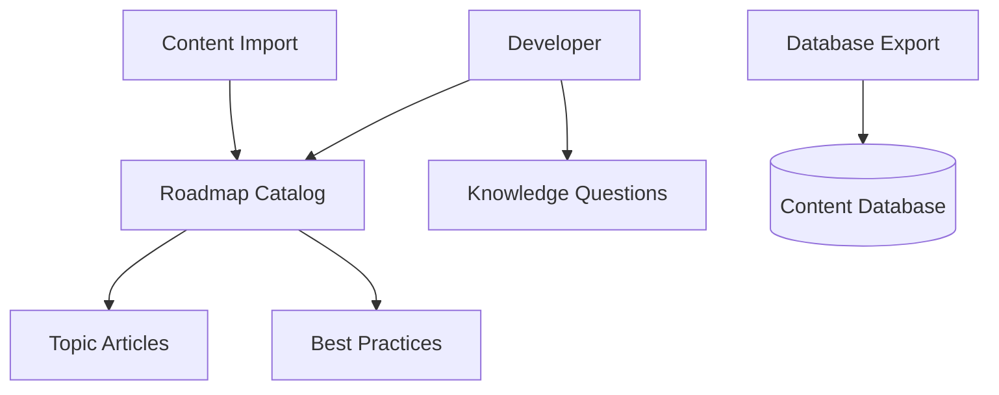

# kamranahmedse/developer-roadmap

> Le contenu des parcours d'apprentissage interactifs de roadmap.sh, un fichier Markdown par sujet.

## Le problème
Savoir quoi apprendre, dans quel ordre, quand on vise un métier de développeur ou de l'IA.

## Ce que ça fait vraiment
Le dépôt contient les textes des nœuds des roadmaps, rangés en `roadmaps/<slug>/content/<topic-slug>@<node-id>.md`. Les modifications fusionnées sont synchronisées automatiquement vers le site. Le catalogue couvre notamment frontend, backend, agents IA et data scientist IA.

## Comment c'est branché
Schéma simplifié d'après la diagramme fourni.



## Essayer
```bash
git clone git@github.com:nilbuild/developer-roadmap.git --depth 1
cd developer-roadmap
```

## Coût et pièges
Gratuit. Le dépôt n'est pas l'application : l'expérience interactive est sur roadmap.sh. La licence est présente mais non identifiée par GitHub.

## Ce que ce n'est pas
Ce n'est pas un outil à installer ni le code du site : le runtime n'est pas dans le dépôt. Les scripts de synchronisation sont réservés aux mainteneurs.

## Alternatives
Aucune alternative nommée dans le README.

## Pour toi
À consulter en ligne comme carte de montée en compétence (roadmaps IA et data), sans rien cloner : le dépôt n'apporte que du contenu.

