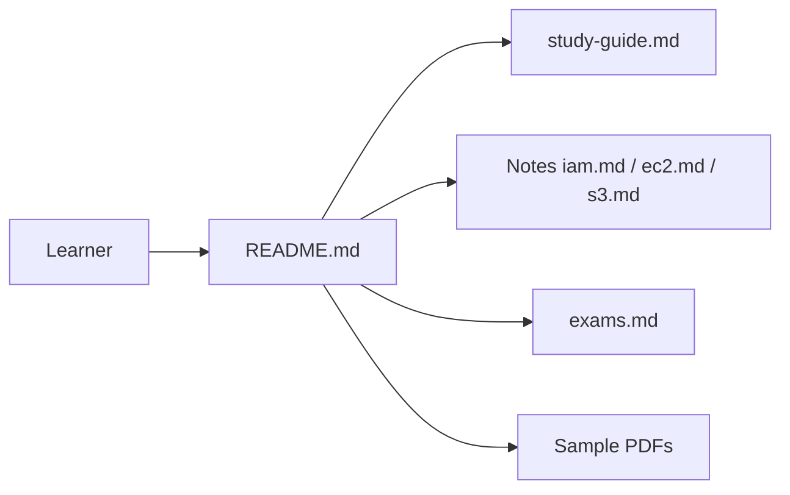

# kananinirav/AWS-Certified-Cloud-Practitioner-Notes

> Study notes for the AWS Cloud Practitioner CLF-C02 exam, for beginner candidates.

## The problem
Quickly reviewing the syllabus of the entry-level AWS certification.

## What it actually does
Markdown notes by topic: cloud basics, IAM, EC2, ELB/ASG, S3, databases, VPC, monitoring, security, billing, ML. A study guide, a mind map, practice exams (partly paid, as Kindle/Leanpub PDFs). The README is short (insufficient material).

## How it is wired

## Trying it
No documented command: just read the Markdown files.

## Cost and gotchas
Notes are free; full PDFs and practice exams are paid. The repository targets CLF-C02, an exam version that may change.

## What it is not
Not an official AWS course nor a guarantee of passing.

## Alternatives
No alternative named in the README (the same author offers AI Practitioner and AZ-900 notes).

## For you
Ignore unless you are taking this entry-level certification; too generalist for an already-trained MLOps profile.
