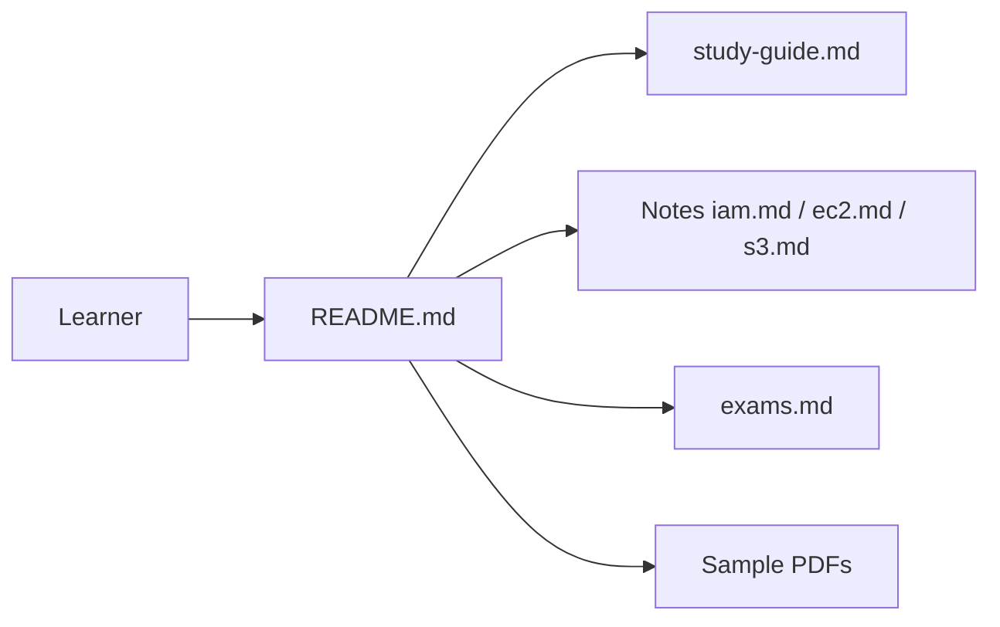

# kananinirav/AWS-Certified-Cloud-Practitioner-Notes

> Notes de révision pour l'examen AWS Cloud Practitioner CLF-C02, pour candidats débutants.

## Le problème
Réviser rapidement le programme de la certification AWS de base.

## Ce que ça fait vraiment
Notes Markdown par thème : bases du cloud, IAM, EC2, ELB/ASG, S3, bases de données, VPC, surveillance, sécurité, facturation, ML. Un guide d'étude, une carte mentale, des examens blancs (en partie payants en PDF Kindle/Leanpub). Le README est court (matière insuffisante).

## Comment c'est branché

## Essayer
Aucune commande documentée : lecture des fichiers Markdown.

## Coût et pièges
Notes gratuites ; PDF complets et examens blancs payants. Le dépôt vise la CLF-C02, version d'examen susceptible d'évoluer.

## Ce que ce n'est pas
Pas un cours officiel AWS ni une garantie de réussite.

## Alternatives
Aucune alternative nommée dans le README (le même auteur propose des notes AI Practitioner et AZ-900).

## Pour toi
À ignorer sauf si tu passes cette certification d'entrée ; trop généraliste pour un profil MLOps déjà formé.

