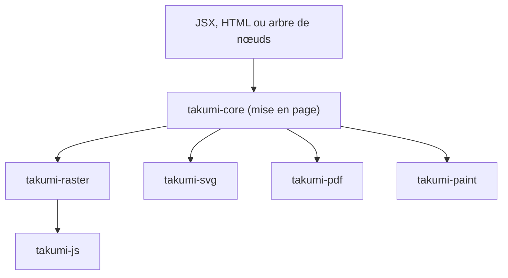

# kane50613/takumi

> Rust layout engine that turns JSX, HTML and CSS into images, SVG or PDF without a browser.

## The problem
Generating share images or PDFs with Puppeteer or a headless browser is heavy, slow and fragile in serverless.

## What it actually does
Converts JSX or HTML into a node tree, lays it out in takumi-core (blocks, flexbox, grid, tables, text taken from Chromium) then sends it to four outputs: raster (PNG, JPEG, WebP, animated GIF), SVG, paginated PDF with selectable text, or a paint tree. It runs as a native Node or Bun binding, in WebAssembly (Cloudflare Workers, browsers) and as a Rust crate. It supports Tailwind v4.

## How it is wired


## Trying it
```bash
bun i takumi-js
bun i takumi-pdf
bun i takumi-paint
bun image.tsx
cargo add takumi
```

## Cost and gotchas
Free. Only a subset of CSS: the PDF rejects blur() and drop-shadow(), and remote resources must be preloaded. Keep Puppeteer if your output depends on page scripts.

## What it is not
Not a browser: no page JavaScript is executed. Not a PDF editor.

## Alternatives
- satori: predecessor for SVG images, comparison provided in the docs.
- Puppeteer or Playwright: preferable if the rendering requires a real browser.
- @react-pdf/renderer: preferable to keep a dedicated PDF component API.

## For you
Watch: handy for producing report share cards or PDFs from a service, without bundling Chromium.
