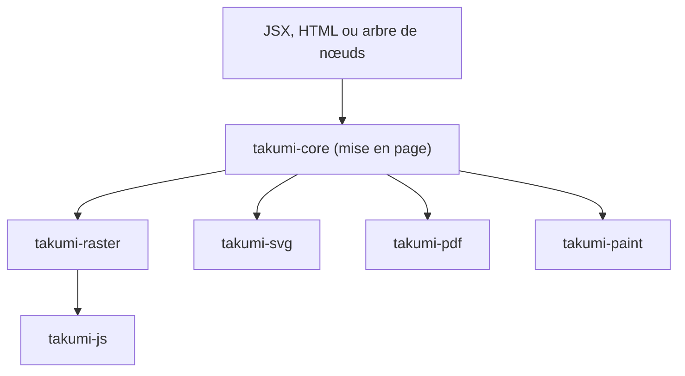

# kane50613/takumi

> Moteur de mise en page en Rust qui transforme JSX, HTML et CSS en images, SVG ou PDF sans navigateur.

## Le problème
Générer des images de partage ou des PDF avec Puppeteer ou un navigateur headless est lourd, lent et fragile en serverless.

## Ce que ça fait vraiment
Convertit JSX ou HTML en arbre de nœuds, le met en page dans takumi-core (blocs, flexbox, grille, tableaux, texte repris de Chromium) puis l'envoie vers quatre sorties : raster (PNG, JPEG, WebP, GIF animé), SVG, PDF paginé à texte sélectionnable, ou arbre de peinture. Il tourne en binding natif Node ou Bun, en WebAssembly (Cloudflare Workers, navigateurs) et en crate Rust. Il gère Tailwind v4.

## Comment c'est branché


## Essayer
```bash
bun i takumi-js
bun i takumi-pdf
bun i takumi-paint
bun image.tsx
cargo add takumi
```

## Coût et pièges
Gratuit. Sous-ensemble de CSS seulement : le PDF refuse blur() et drop-shadow(), et il faut précharger les ressources distantes. Garde Puppeteer si ta sortie dépend de scripts de page.

## Ce que ce n'est pas
Pas un navigateur : aucun JavaScript de page exécuté. Pas un éditeur de PDF.

## Alternatives
- satori : prédécesseur pour les images SVG, comparaison fournie dans la doc.
- Puppeteer ou Playwright : à préférer si le rendu exige un vrai navigateur.
- @react-pdf/renderer : à préférer pour garder une API de composants PDF dédiée.

## Pour toi
Surveiller : pratique pour produire des cartes de partage de rapports ou des PDF depuis un service, sans embarquer Chromium.

