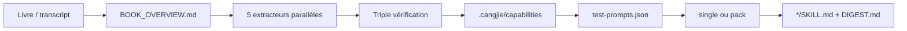

# kangarooking/cangjie-skill

> Methodology and templates to distill books, videos and podcasts into agent skills.

## The problem
Books read, videos saved, podcasts listened to: the knowledge stays at the note stage and
is never recalled at the moment of a real decision.

## What it actually does
Applies a seven-step pipeline, **RIA-TV++**: global understanding using the Adler method
(`BOOK_OVERVIEW.md`), five parallel extractors (frameworks, principles, cases, counter-examples, glossary),
triple verification with a promotion gate, building R/I/A1/A2/E/B capability cards in
`.cangjie/capabilities/`, Zettelkasten-style linking, stress tests with trick questions,
then deterministic compilation into `single` (one router skill) or `pack` (router + standalone skills).
A single local tool, `scripts/cangjie.py`, covers diagnosis, compilation, update, repair, rollback.

## How it is wired


## Trying it
```bash
mkdir -p ~/.dsh/packages
curl -fL "https://github.com/kangarooking/cangjie-skill/releases/download/v2.5.0/dsh-cangjie-skill-2.5.0.tgz" \
  -o ~/.dsh/packages/dsh-cangjie-skill-2.5.0.tgz
(cd ~/.dsh/packages && shasum -a 256 -c dsh-cangjie-skill-2.5.0.tgz.sha256)
dsh plugin --profile web add ~/.dsh/packages/dsh-cangjie-skill-2.5.0.tgz
```

## Cost and gotchas
Free, MIT license declared in the file tree. The real cost is that of the model calls during
extraction, not quantified. Pitfall flagged by the project: GitHub's automatic archives do not contain
the refresh of September 13, 2026 — download the republished package and check `BUILD_INFO.json`.

## What it is not
Not a summarizer: the stated goal is structured reuse, not narrative compression.
Not a video downloader — you need a companion skill to obtain the transcript.
A project carried by a single person, with a strong self-promotion component.

## Alternatives
- **nuwa-skill**: distills people (style, way of thinking) rather than content.
- **darwin-skill**: evolves existing skills instead of creating new ones.

## For you
The method is worth more than the tool: read it to structure your own skills, without necessarily installing it.
