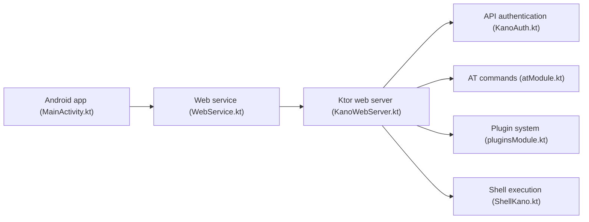

# kanoqwq/UFI-TOOLS

> Management and extension tool for Android-based ZTE 4G/5G pocket routers.

## The problem
Administering these devices (signal, bands, SMS, system) without a rich native interface.

## What it actually does
- Band or cell locking without reboot, 3G/4G/5G switching, signal measurements.
- SMS (send, receive, automatic forwarding), AT command terminal, SSH.
- Plugin store (AdGuardHome, EasyTier, crontab…).
- Web console at `http://IP:2333`, Android application (Ktor); "PE" version to install on a phone.

## How it is wired

## Trying it
No command documented: installation via videos (Bilibili), guided installation or Magisk module.

## Cost and gotchas
The "advanced features" give root access; the README advises backing up your data. Documentation in Chinese.

## What it is not
Not a general-purpose tool: limited to certain tested ZTE/Unisoc models.

## Alternatives
No alternative named in the README.

## For you
Ignore: niche network hardware, unrelated to data/AI/MLOps.
