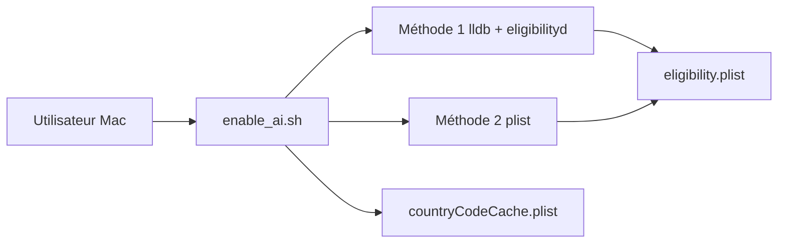

# kanshurichard/enableAppleAI

> Shell script that force-enables Apple Intelligence on Macs sold in China.

## The problem
Apple Intelligence is blocked on Chinese-market Macs by the system's eligibility checks.

## What it actually does
Script `enable_ai.sh`, with two methods: modifying `/private/var/db/eligibilityd/eligibility.plist` (with lldb injection to simulate a US model), or editing the plists only. Locks the files with `uchg`; option to force the `US` region via `countryCodeCache.plist`. Restore menu included.

## How it is wired


## Trying it
```bash
curl -sL https://raw.githubusercontent.com/kanshurichard/enableAppleAI/main/enable_ai.sh | bash
```

## Cost and gotchas
Requires disabling SIP and `sudo` rights. The README warns that the method fails from macOS 26.5 beta 4 onward and advises against updating. iPhone Mirroring pitfall if the region is changed before pairing.

## What it is not
Not an official solution: a system workaround, archived, unlicensed and with no fix for recent versions.

## Alternatives
- hyderay/AiOnMac: source of inspiration for method 2.

## For you
Ignore: an archived workaround tool that requires disabling SIP and piping a remote script into bash, unrelated to data/AI work.
