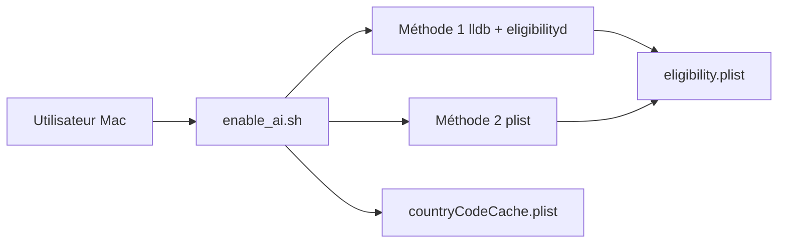

# kanshurichard/enableAppleAI

> Script shell qui force l'activation d'Apple Intelligence sur des Mac vendus en Chine.

## Le problème
Apple Intelligence est bloquée sur les Mac de marché chinois par les vérifications d'éligibilité du système.

## Ce que ça fait vraiment
Script `enable_ai.sh`, avec deux méthodes : modification de `/private/var/db/eligibilityd/eligibility.plist` (avec injection lldb pour simuler un modèle américain), ou édition des plists seule. Verrouille les fichiers avec `uchg` ; option de forcer la région `US` via `countryCodeCache.plist`. Menu de restauration inclus.

## Comment c'est branché


## Essayer
```bash
curl -sL https://raw.githubusercontent.com/kanshurichard/enableAppleAI/main/enable_ai.sh | bash
```

## Coût et pièges
Exige de désactiver SIP et des droits `sudo`. Le README prévient que la méthode échoue à partir de macOS 26.5 beta 4 et déconseille de mettre à jour. Piège iPhone Mirroring si la région est changée avant l'appairage.

## Ce que ce n'est pas
Pas une solution officielle : un contournement de système, archivé, sans licence et sans correctif pour les versions récentes.

## Alternatives
- hyderay/AiOnMac : source d'inspiration de la méthode 2.

## Pour toi
À ignorer : outil de contournement archivé, qui demande de désactiver SIP et de piper un script distant dans bash, sans rapport avec le travail data/IA.

