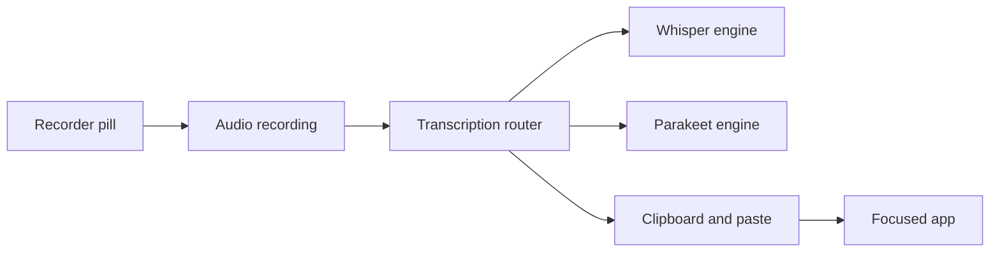

# karansinghgit/speaktype

> Local voice dictation app for macOS, Windows and Linux, which types into any application.

## The problem
Dictation tools send your voice to servers and cost a subscription.

## What it actually does
You hold a shortcut, speak, and the transcription is pasted wherever the cursor is. Whisper models (99 languages) and Parakeet (English + 24 European languages), downloaded once (75 MB to 1.6 GB). Corrections dictionary, filler-word removal, local history.

## How it is wired


## Trying it
```bash
sudo apt install ./SpeakType_*.deb
chmod +x SpeakType_*.AppImage
```

## Cost and gotchas
Free, no account. Unsigned applications: manual approvals on Mac and Windows. Microphone and accessibility permissions are requested. Windows and Linux are described as very young.

## What it is not
Not a cloud service nor AI text cleanup (announced as "coming soon"). The engines are those of whisper.cpp, ONNX Runtime, WhisperKit and FluidAudio.

## Alternatives
No alternative named in the README.

## For you
Watch: a concrete example of local speech recognition (Whisper/Parakeet) worth testing, but the project is young.
