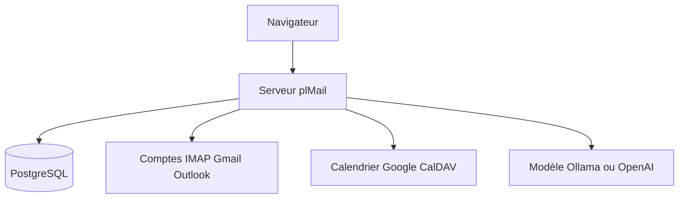

# karatektus/pl_mail

> Self-hosted mail client with calendar, which gathers IMAP, Gmail and Outlook into a single inbox.

## The problem
Several mailboxes and calendars scattered across providers, with no shared search and no control over your data.

## What it actually does
- Synchronizes IMAP, Gmail and Outlook into your own PostgreSQL database, with full-text search.
- Calendar synchronized with Google, Microsoft and CalDAV.
- Tree filters, labels, drag and drop, two-factor authentication, OIDC.
- An optional language model (Ollama or OpenAI-compatible endpoint): semantic search, drafts, summaries; each feature is disabled by default.

## How it is wired

Simplified diagram based on the sheet, no diagram provided.

## Trying it
```bash
git clone https://github.com/karatektus/pl_mail.git
cd pl_mail
docker compose up -d
```

## Cost and gotchas
Gmail and Outlook require Google or Microsoft OAuth credentials. Back up the database and `var/secrets/generated.env` separately: losing the key makes the stored passwords unusable.

## What it is not
Not a mail server: it receives nothing from the Internet and hosts no domain. The mobile apps are separate repos, Android paid on Play.

## Alternatives
No alternative named in the README.

## For you
Worth watching: interesting for keeping your mail at home with a local LLM, but the project dates from July 2026 and relies on a single person.
