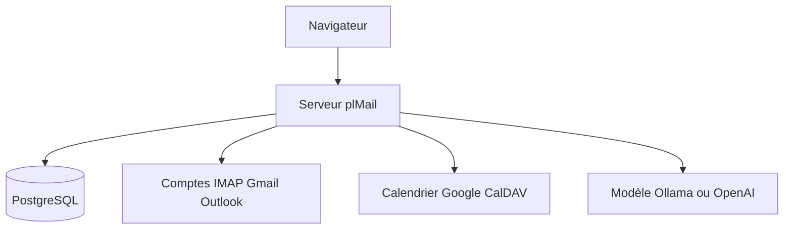

# karatektus/pl_mail

> Client mail auto-hébergé avec calendrier, qui rassemble IMAP, Gmail et Outlook dans une boîte unique.

## Le problème
Plusieurs boîtes mail et calendriers éparpillés chez des fournisseurs, sans recherche commune ni contrôle sur ses données.

## Ce que ça fait vraiment
- Synchronise IMAP, Gmail et Outlook dans une base PostgreSQL à toi, avec une recherche plein texte.
- Calendrier synchronisé avec Google, Microsoft et CalDAV.
- Filtres en arbre, étiquettes, glisser-déposer, authentification à deux facteurs, OIDC.
- Un modèle de langage optionnel (Ollama ou endpoint compatible OpenAI) : recherche sémantique, brouillons, résumés ; chaque fonction est désactivée par défaut.

## Comment c'est branché

Schéma simplifié d'après la fiche, sans diagramme fourni.

## Essayer
```bash
git clone https://github.com/karatektus/pl_mail.git
cd pl_mail
docker compose up -d
```

## Coût et pièges
Gmail et Outlook demandent des identifiants OAuth Google ou Microsoft. Sauvegarder séparément la base et `var/secrets/generated.env` : perdre la clé rend les mots de passe stockés inutilisables.

## Ce que ce n'est pas
Ce n'est pas un serveur mail : il ne reçoit rien d'Internet et n'héberge pas de domaine. Les applications mobiles sont des dépôts séparés, Android payant sur Play.

## Alternatives
Aucune alternative nommée dans le README.

## Pour toi
À surveiller : intéressant pour garder son courrier chez soi avec un LLM local, mais le projet date de juillet 2026 et repose sur une seule personne.

