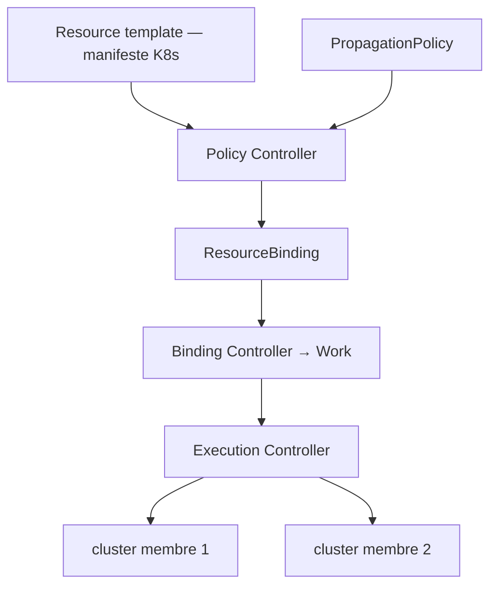

# karmada-io/karmada

> Multi-cluster Kubernetes orchestrator that propagates applications without modifying them.

## The problem
Deploying the same application across several clusters and clouds means duplicating manifests and handling failover by hand when something goes down.
Each vendor pushes its own solution, and therefore its own lock-in.

## What it actually does
It speaks the native Kubernetes APIs: a resource template is a standard manifest, and a separate `PropagationPolicy` describes where and how it spreads.
An `OverridePolicy` specializes the configuration per cluster — image prefix by region, StorageClass by provider.
Four controllers do the work: Cluster (attachment), Policy (resource selection), Binding (Work creation), Execution (distribution to member clusters).
Scheduling policies cover cluster affinity, multi-cluster splitting and rebalancing, and HA by region, AZ, cluster or provider.

## How it is wired


## Trying it
```bash
git clone https://github.com/karmada-io/karmada
cd karmada
hack/local-up-karmada.sh
export KUBECONFIG="$HOME/.kube/karmada.config"
kubectl create -f samples/nginx/deployment.yaml
kubectl create -f samples/nginx/propagationpolicy.yaml
kubectl get deployment
```

## Cost and gotchas
Free, graduated CNCF project. Local installation requires kubectl v1.19+, kind v0.14+ and a Go version matching `go.mod`.
Two contexts coexist: `karmada-apiserver` is the one to use, `karmada-host` is only for debugging the installation — a common source of confusion.

## What it is not
It is not a proprietary overlay: nothing to change in the applications, and compatibility is tested on ten Kubernetes versions.
It is not a brand-new project either — it continues Kubernetes Federation v1 and v2, whose concepts it inherits.

## Alternatives
No alternative is named in the README.

## For you
Relevant only if your inference workloads span several clusters; otherwise it is one layer too many.
