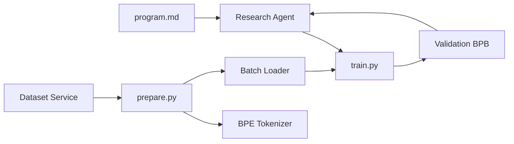

# karpathy/autoresearch

> A loop where an AI agent modifies a small GPT training, runs it for five minutes, and then either keeps or discards it.

## The problem
Manually exploring different architectural options or hyperparameter settings can be time-consuming; we would like an agent to do this automatically, overnight.

## What it actually does
Three files are involved: `prepare.py` downloads the data, trains a BPE tokenizer, and provides data loading and evaluation (unchanged). `train.py` contains the GPT model, the Muon + AdamW optimizer, and the training loop – this is the only file that the agent modifies. `program.md` provides instructions to the agent – this is the file that a human would modify.

Each run takes approximately 5 minutes; the metric is `val_bpb` (lower = better), and it is independent of the vocabulary size. Approximately 12 runs per hour.

## How it is wired


## Trying it
```bash
curl -LsSf https://astral.sh/uv/install.sh | sh
uv sync
uv run prepare.py
uv run train.py
```

## Cost and gotchas
An NVIDIA GPU (tested on H100), Python 3.10+, uv, plus the agent's subscription or API (Claude, Codex). The README recommends disabling all agent permissions: this is a real risk on your machine.

## What it is not
The orchestration and historical data are not stored: the agent is responsible for managing them. Results are not comparable between machines, as the timing is the key factor. There is no distributed training.

## Alternatives
- miolini/autoresearch-macos — for macOS.
- trevin-creator/autoresearch-mlx — for macOS via MLX.
- andyluo7/autoresearch — for AMD GPUs.

## For you
This should be used as a template for "agent-based research," and should only be run on a single, isolated machine.
