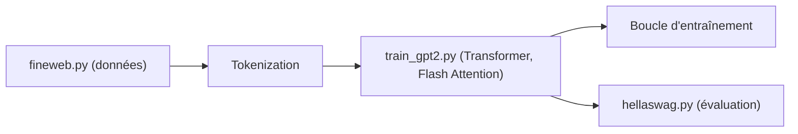

# karpathy/build-nanogpt

> Step-by-step reproduction of GPT-2 (124M) from an empty file, commit by commit, with video.

## The problem
Understanding how a GPT is trained from scratch without drowning in a large repository.

## What it actually does
The git history is deliberately clean so you can follow the construction of `train_gpt2.py`, up to a GPT-2 124M. The README gives about 1 hour and $10 of cloud GPU to reproduce it, and says the code can also reproduce GPT-3 models. The model only completes text: no conversational fine-tuning. Errata listed (bias buffer, uint16 conversion, `device_type`).

## How it is wired


## Trying it
```bash
# Aucune commande documentée dans le README : suivre la vidéo et l'historique des commits.
```

## Cost and gotchas
Cloud GPU at your expense (Lambda recommended). No license declared; last push in August 2024. The exact role of each file is not described in the README.

## What it is not
Not a ChatGPT: you cannot chat with the model. Not a production repository.

## Alternatives
litGPT and TinyLlama: cited for trainings closer to production.

## For you
Adopt as a learning resource: the best way to revisit how a GPT works; do not reuse in a product without a clear license.
