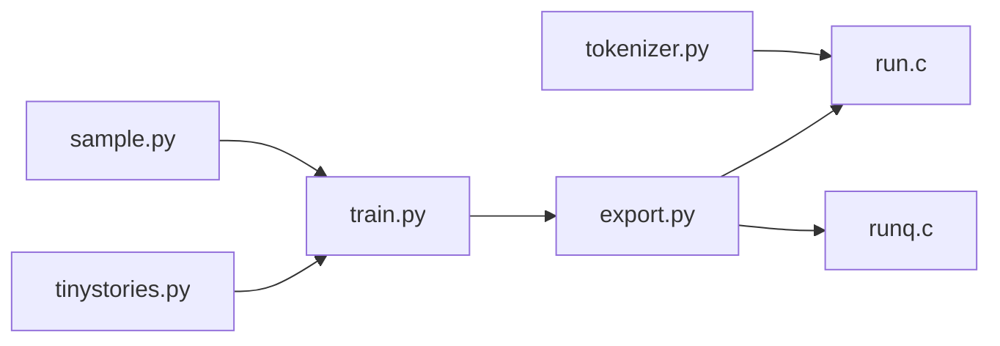

# karpathy/llama2.c

> Train the Llama 2 architecture in PyTorch then run inference with a single C file, for educational purposes.

## The problem
Understanding an LLM end to end without massive dependencies or an opaque inference engine.

## What it actually does
`train.py` and `tinystories.py` train small models; `export.py` produces a `.bin`; `run.c` (fp32) and `runq.c` (int8 Q8_0) do the inference. Also loads Meta's Llama 2 models (7B at most, fp32), compatible HF models, custom tokenizers. OpenMP possible. Quantization and Code Llama are presented as incomplete.

## How it is wired


## Trying it
```bash
git clone https://github.com/karpathy/llama2.c.git
cd llama2.c
wget https://huggingface.co/karpathy/tinyllamas/resolve/main/stories15M.bin
make run
./run stories15M.bin
```

## Cost and gotchas
Free; a GPU is needed to train (4 × A100 for the author's models), not for inference. Last push in 2024-08: the project is no longer moving forward. Beyond 7B it does not work (README). The README text contains an unrelated paragraph about cobalt oxide.

## What it is not
Not a production engine; no GPU for inference; fp32 models are inefficient.

## Alternatives
llama.cpp (cited as a source of inspiration, more complete).

## For you
Adopt, for learning: ideal reading for understanding how an LLM computes; in production, prefer a real inference engine.
