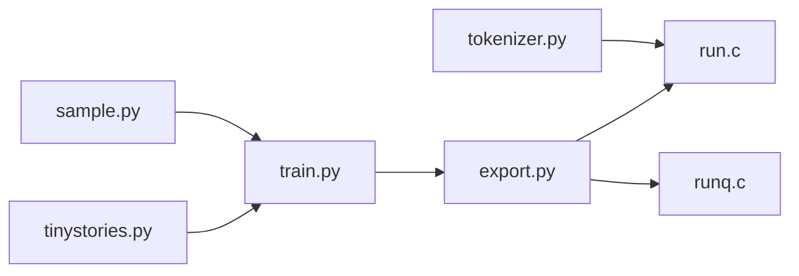

# karpathy/llama2.c

> Entraîner l'architecture Llama 2 en PyTorch puis l'inférer avec un seul fichier C, à visée pédagogique.

## Le problème
Comprendre de bout en bout un LLM sans dépendances massives ni moteur d'inférence opaque.

## Ce que ça fait vraiment
`train.py` et `tinystories.py` entraînent de petits modèles ; `export.py` produit un `.bin` ; `run.c` (fp32) et `runq.c` (int8 Q8_0) font l'inférence. Charge aussi des Llama 2 de Meta (7B au plus, fp32), les modèles HF compatibles, des tokenizers personnalisés. OpenMP possible. Quantification et Code Llama présentés comme incomplets.

## Comment c'est branché


## Essayer
```bash
git clone https://github.com/karpathy/llama2.c.git
cd llama2.c
wget https://huggingface.co/karpathy/tinyllamas/resolve/main/stories15M.bin
make run
./run stories15M.bin
```

## Coût et pièges
Gratuit ; un GPU est nécessaire pour entraîner (4 × A100 pour les modèles de l'auteur), pas pour inférer. Dernier push en 2024-08 : le projet n'avance plus. Au-delà de 7B, ça ne marche pas (README). Le texte du README contient un paragraphe sans rapport sur l'oxyde de cobalt.

## Ce que ce n'est pas
Pas un moteur de production ; pas de GPU en inférence ; modèles fp32 peu efficaces.

## Alternatives
llama.cpp (cité comme source d'inspiration, plus complet).

## Pour toi
Adopter, pour apprendre : lecture idéale pour comprendre le calcul d'un LLM ; en prod, préfère un vrai moteur d'inférence.

