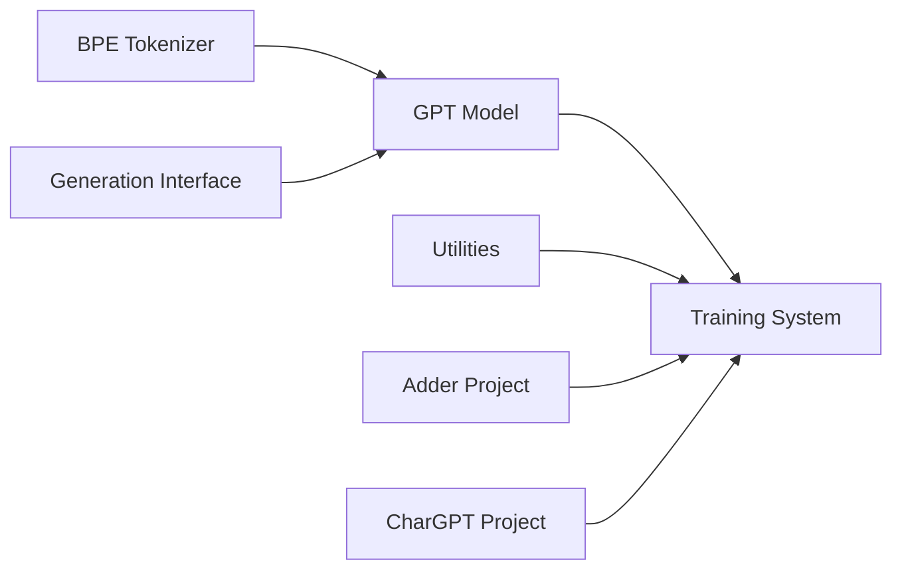

# karpathy/minGPT

> Educational PyTorch reimplementation of GPT (training and inference) in three files.

## The problem
Industrial GPT implementations are too tangled to understand what really happens inside a decoder transformer.

## What it actually does
`mingpt/model.py` (~300 lines) defines the Transformer, `bpe.py` the OpenAI BPE encoder, `trainer.py` the training loop.
Can load pre-trained GPT-2 (`generate.ipynb`).
Example projects: `adder` (addition), `chargpt` (character-level model), `demo.ipynb` (sorting).
Detailed reading notes on the GPT-1/2/3 and Image GPT papers.

## How it is wired


## Trying it
```bash
git clone https://github.com/karpathy/minGPT.git
cd minGPT
pip install -e .
python -m unittest discover tests
```

## Cost and gotchas
Free; no requirements.txt. Semi-archived since 2023.

## What it is not
Not a production tool: no mixed precision or distributed training.

## Alternatives
- nanoGPT: the author's rewrite, simple yet able to reproduce benchmarks.
- huggingface/transformers: complete, but harder to trace.

## For you
Watch as a learning resource: perfect for teaching a team how GPT works, but nanoGPT is the choice for experimenting.
