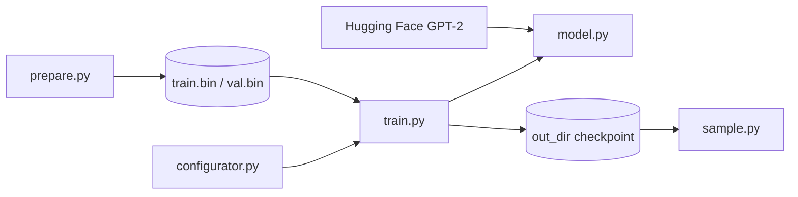

# karpathy/nanoGPT

> Minimal code to train or fine-tune medium-sized GPTs; declared obsolete by its author.

## The problem
Understanding or reproducing GPT training is hard with heavy frameworks where the loop gets lost in abstractions.

## What it actually does
`model.py` (~300 lines) defines a GPT and can load OpenAI's GPT-2 weights; `train.py` (~300 lines) loads binary token streams (`train.bin`, `val.bin`), trains, evaluates and saves to `out_dir`; `sample.py` generates text from a checkpoint.
Per-dataset `prepare.py` scripts (character-level Shakespeare, OpenWebText) tokenize upstream. `configurator.py` applies a config file and `--key=value` overrides. DDP via `torchrun`, `torch.compile`, CPU and MPS possible. GPT-2 124M can be reproduced in ~4 days on 8×A100.

## How it is wired


## Trying it
```bash
pip install torch numpy transformers datasets tiktoken wandb tqdm
python data/shakespeare_char/prepare.py
python train.py config/train_shakespeare_char.py
python sample.py --out_dir=out-shakespeare-char
```

## Cost and gotchas
Free, MIT. A GPU for useful experiments (3 min on an A100 for Shakespeare); possible on CPU by shrinking everything. Wandb is optional.

## What it is not
No longer maintained: the author calls it "very old and deprecated" and points to nanochat. Neither a server nor a production pipeline: study scripts.

## Alternatives
- nanochat — its successor, designated by the author himself.

## For you
Ignore in favor of nanochat; only to reread a minimal training loop.
