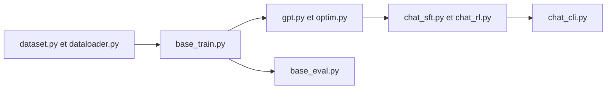

# karpathy/nanochat

> Minimal test bench for training a small LLM end to end on a single GPU node.

## The problem
Understanding or reproducing the full training of a language model (tokenization, pre-training, SFT, RL, inference) is hard with large codebases.

## What it actually does
Short Python/PyTorch code covering the whole cycle: BPE tokenizer, data loader, pre-training, evaluation (CORE, bits per byte), SFT finetuning, RL, terminal chat interface. A single setting, `--depth`, derives the other hyperparameters. The README puts a GPT-2-level model at about 48 dollars (8 H100s, ~2 hours) and keeps a "time to GPT-2" leaderboard.

## How it is wired


## Trying it
```bash
uv sync --extra gpu
source .venv/bin/activate
bash runs/speedrun.sh
python -m scripts.chat_cli
```

## Cost and gotchas
Renting an 8 H100 node (~24 dollars/hour according to the README). With less than 80 GB of VRAM: reduce `--device-batch-size`. CPU or MPS version: weak results. Tracking via wandb.

## What it is not
It is not a ready-to-use model or a useful chatbot: the result looks like a "kindergartener", says the README. It is an experimental test bench.

## Alternatives
No alternative named in the README (inspired by modded-nanogpt).

## For you
Adopt as a learning tool: reading this code teaches end-to-end training for the price of a weekend of GPU time.
