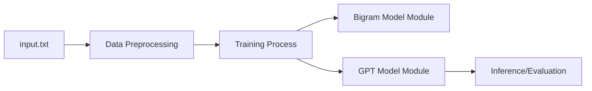

# karpathy/ng-video-lecture

> Code for Karpathy's nanoGPT lesson: a bigram model and then a mini GPT, for learning.

## The problem
Understanding how a GPT-style language model is built, line by line, without a heavy framework.

## What it actually does
Two scripts, `bigram.py` (bigram model) and `gpt.py` (mini transformer), train on `input.txt`. The git history follows the video. The author notes that weight initialization is not handled as in nanoGPT: convergence is slower.

## How it is wired

## Trying it
No command documented in the README (the scripts are `bigram.py` and `gpt.py`).

## Cost and gotchas
A GPU speeds up training; the README does not mention it. No license: reuse is legally unclear.

## What it is not
It is not nanoGPT: module names differ and copy-pasting is not possible. The promised initialization fix is not published.

## Alternatives
- nanoGPT (cited in the README): up-to-date code with `_init_weights`.

## For you
Watch: a good teaching resource to follow along with the video, but frozen since January 2024 and without a license.
