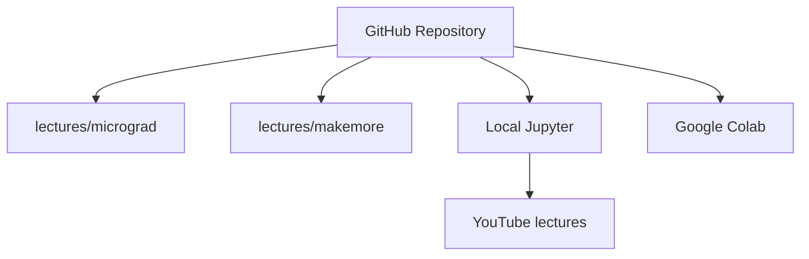

# karpathy/nn-zero-to-hero

> Video course and notebooks to learn neural networks, from backpropagation to GPT.

## The problem
Truly understanding backpropagation, language models and Transformers rather than using black boxes.

## What it actually does
Eight YouTube video lessons with Jupyter notebooks: micrograd, makemore (bigrams, MLP, BatchNorm, manual backpropagation, WaveNet), building a GPT and the tokenizer. Exercises are in the video descriptions. The course is still evolving according to the author.

## How it is wired

## Trying it
No command in the README: open the notebooks in `lectures/` locally or on Colab.

## Cost and gotchas
Free. Python, PyTorch and Jupyter required. You need to follow the videos: the README is not self-sufficient.

## What it is not
Not a library nor an up-to-date complete course (last push 2024); earlier lessons are assumed known in later ones.

## Alternatives
- micrograd and makemore (the author's repositories): the code for the first two series.

## For you
Adopt: a solid foundation for a data/AI profile, timeless even though the repository is barely active.
