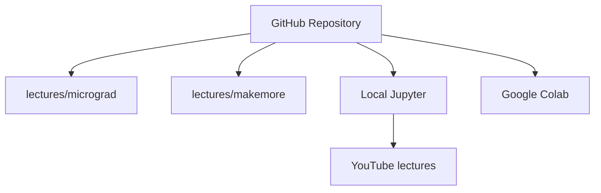

# karpathy/nn-zero-to-hero

> Cours vidéo et notebooks pour apprendre les réseaux de neurones, de la rétropropagation au GPT.

## Le problème
Comprendre vraiment backpropagation, modèles de langage et Transformers plutôt qu'utiliser des boîtes noires.

## Ce que ça fait vraiment
Huit leçons vidéo YouTube avec notebooks Jupyter : micrograd, makemore (bigrammes, MLP, BatchNorm, rétropropagation à la main, WaveNet), construction d'un GPT et du tokenizer. Des exercices sont dans les descriptions des vidéos. Cours en cours d'évolution selon l'auteur.

## Comment c'est branché

## Essayer
Aucune commande dans le README : ouvrir les notebooks de `lectures/` en local ou sur Colab.

## Coût et pièges
Gratuit. Python, PyTorch et Jupyter requis. Il faut suivre les vidéos : le README ne se suffit pas.

## Ce que ce n'est pas
Pas une bibliothèque ni une formation complète à jour (dernier push 2024) ; les leçons précédentes sont supposées connues dans les suivantes.

## Alternatives
- micrograd et makemore (dépôts de l'auteur) : le code des deux premières séries.

## Pour toi
À adopter : base solide pour un profil data/IA, intemporelle même si le dépôt est peu actif.

