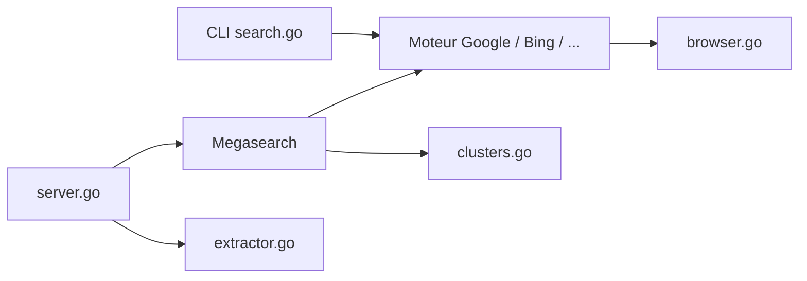

# karust/openserp

> Self-hosted API and CLI for Google, Bing, Yandex and other search results, for agents and SEO.

## The problem
Paid search APIs bill every request and do not cover every engine; agents need structured results.

## What it actually does
Queries six engines (Google, Yandex, Baidu, Bing, DuckDuckGo, Ecosia) through a browser or raw HTTP and returns the same JSON schema. Megasearch merges and deduplicates several engines, and extraction adds page content as Markdown. Images, filters, proxies, cache. JSON, Markdown, text and NdJSON formats; JS and Python SDKs, an MCP server, an n8n node.

## How it is wired


## Trying it
```bash
docker run --rm -p 127.0.0.1:7000:7000 karust/openserp:latest serve -a 0.0.0.0 -p 7000
go install github.com/karust/openserp@latest
openserp search duckduckgo "open source serp api" --format markdown
curl "http://127.0.0.1:7000/google/search?text=golang&limit=10"
```

## Cost and gotchas
No API key, but you need a browser or proxies; engines may block or change their HTML. A paid cloud version exists with the same schema.

## What it is not
Not an official API of the engines: it is scraping, therefore fragile and possibly against the terms of use. No availability guarantee.

## Alternatives
- OpenSERP Cloud: the same API, hosted.

## For you
Worth watching: handy for giving an agent search without a key, but the fragility of scraping rules out making it a critical dependency.
