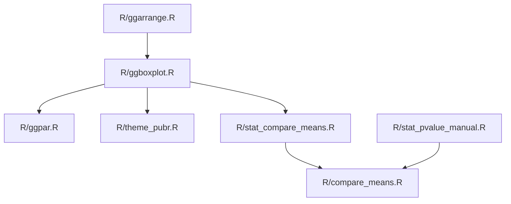

# kassambara/ggpubr

> R package that simplifies ggplot2 to produce publication-ready charts, with statistical tests.

## The problem
Default ggplot2 charts require a lot of formatting and opaque syntax for researchers who are not comfortable with R.

## What it actually does
Simple functions (ggboxplot, ggviolin, ggbarplot, ggdotchart, gghistogram) with palettes, sorting and annotations. P-values and comparisons go through stat_compare_means, compare_means and geom_pwc. Version 1.1.0 adds ggcompare, ggrocplot (ROC curves with AUC), ggestimates, ggraincloud and ggvolcano.

## How it is wired


## Trying it
```bash
# Dans R :
install.packages("ggpubr")
devtools::install_github("kassambara/ggpubr")
```

## Cost and gotchas
Free. No license on the GitHub side (the CRAN package may declare one, to be checked). The p-values from stat_compare_means comparisons are not adjusted.

## What it is not
Not a Python tool. Not a statistics engine: it relies on ggplot2 and R's base tests.

## Alternatives
ggplot2 alone, of which ggpubr is a layer on top.

## For you
Adopt it if you make statistical figures in R (ROC, group comparisons); otherwise off-topic, and check the license before any commercial use.
