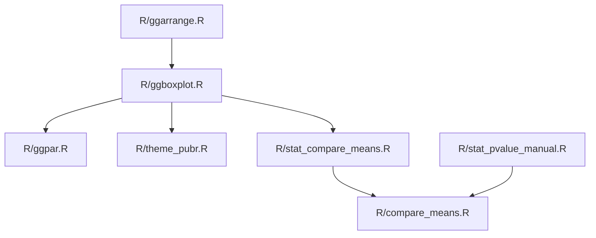

# kassambara/ggpubr

> Paquet R qui simplifie ggplot2 pour produire des graphiques prêts à publier, avec tests statistiques.

## Le problème
Les graphiques ggplot2 par défaut demandent beaucoup de mise en forme et une syntaxe opaque pour des chercheurs peu à l'aise avec R.

## Ce que ça fait vraiment
Fonctions simples (ggboxplot, ggviolin, ggbarplot, ggdotchart, gghistogram) avec palettes, tri et annotations. Les valeurs p et comparaisons passent par stat_compare_means, compare_means et geom_pwc. La version 1.1.0 ajoute ggcompare, ggrocplot (courbes ROC avec AUC), ggestimates, ggraincloud et ggvolcano.

## Comment c'est branché


## Essayer
```bash
# Dans R :
install.packages("ggpubr")
devtools::install_github("kassambara/ggpubr")
```

## Coût et pièges
Gratuit. Licence absente côté GitHub (le paquet CRAN peut en déclarer une, à vérifier). Les p-values avec comparisons de stat_compare_means ne sont pas ajustées.

## Ce que ce n'est pas
Pas un outil Python. Pas un moteur statistique : il s'appuie sur ggplot2 et les tests de base de R.

## Alternatives
ggplot2 seul, dont ggpubr est une surcouche.

## Pour toi
À adopter si tu fais des figures statistiques en R (ROC, comparaisons de groupes) ; sinon hors sujet, et vérifie la licence avant tout usage commercial.

