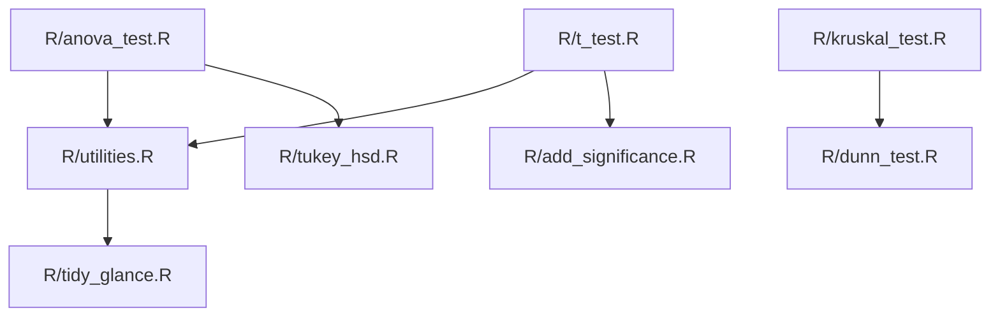

# kassambara/rstatix

> R package for statistical tests compatible with the tidyverse, returning clean tables ready to plot.

## The problem
Base R statistical tests return heterogeneous objects that are hard to chain with dplyr and ggplot2.

## What it actually does
Each test function (`t_test`, `wilcox_test`, `anova_test`, `kruskal_test`...) returns a tibble. It adds post hoc tests (Tukey, Dunn, Games-Howell), effect sizes, correlations, p-value adjustment and significance marks for ggpubr plots.

## How it is wired


## Trying it
```bash
Rscript -e 'install.packages("rstatix")'
Rscript -e 'devtools::install_github("kassambara/rstatix")'
```

## Cost and gotchas
Free. The catalogue declares no license (the package is on CRAN). R is required, and `anova_test` relies on `car`. The README that was read is truncated at the correlation section.

## What it is not
Not a machine learning tool: it is classical inferential statistics.

## Alternatives
No alternative named in the README.

## For you
Worth watching: very handy if you do statistical analysis in R, of no interest if you stay in Python.
