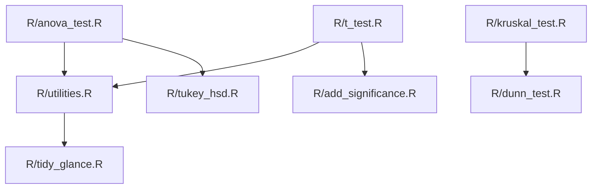

# kassambara/rstatix

> Package R de tests statistiques compatible tidyverse, aux résultats en tableaux propres prêts à tracer.

## Le problème
Les tests statistiques de base en R renvoient des objets hétérogènes, difficiles à enchaîner avec dplyr et ggplot2.

## Ce que ça fait vraiment
Chaque fonction de test (`t_test`, `wilcox_test`, `anova_test`, `kruskal_test`...) renvoie un tibble. Il ajoute des tests post hoc (Tukey, Dunn, Games-Howell), des tailles d'effet, des corrélations, l'ajustement des p-values et les marques de significativité pour les graphiques ggpubr.

## Comment c'est branché


## Essayer
```bash
Rscript -e 'install.packages("rstatix")'
Rscript -e 'devtools::install_github("kassambara/rstatix")'
```

## Coût et pièges
Gratuit. Le catalogue ne déclare pas de licence (le paquet est sur CRAN). Il faut R, et `anova_test` s'appuie sur `car`. Le README lu est tronqué à la partie corrélation.

## Ce que ce n'est pas
Pas un outil de machine learning : de la statistique inférentielle classique.

## Alternatives
Aucune alternative nommée dans le README.

## Pour toi
À surveiller : très pratique si tu fais des analyses statistiques en R, sans intérêt si tu restes en Python.

