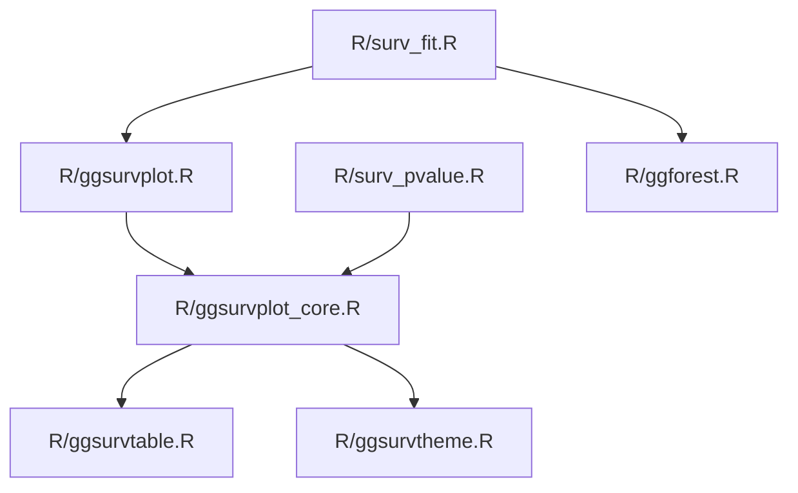

# kassambara/survminer

> R package that draws survival curves, Cox forest plots and diagnostics, for statisticians.

## The problem
R's base survival plots are austere: no at-risk table, and the p-value has to be added by hand.

## What it actually does
`ggsurvplot` draws Kaplan-Meier curves with a risk table, p-value and confidence intervals. Other functions cover Cox model diagnostics, forest plots, competing risks, RMST and CDISC ADTTE data preparation.

## How it is wired


## Trying it
```bash
# dans R
install.packages("survminer")
library("survminer")
require("survival")
fit <- survfit(Surv(time, status) ~ sex, data = lung)
ggsurvplot(fit, data = lung)
```

## Cost and gotchas
Free. Requires R and the survival package. No license declared on GitHub: check the CRAN license before any commercial use.

## What it is not
It is not an estimation engine: it relies on survival for model fitting. It focuses on plotting, not on modeling.

## Alternatives
- survival (used underneath, for fitting, without rich plots).

## For you
Keep an eye on it: useful only if you do survival analysis in R; nothing for a Python or MLOps pipeline.
