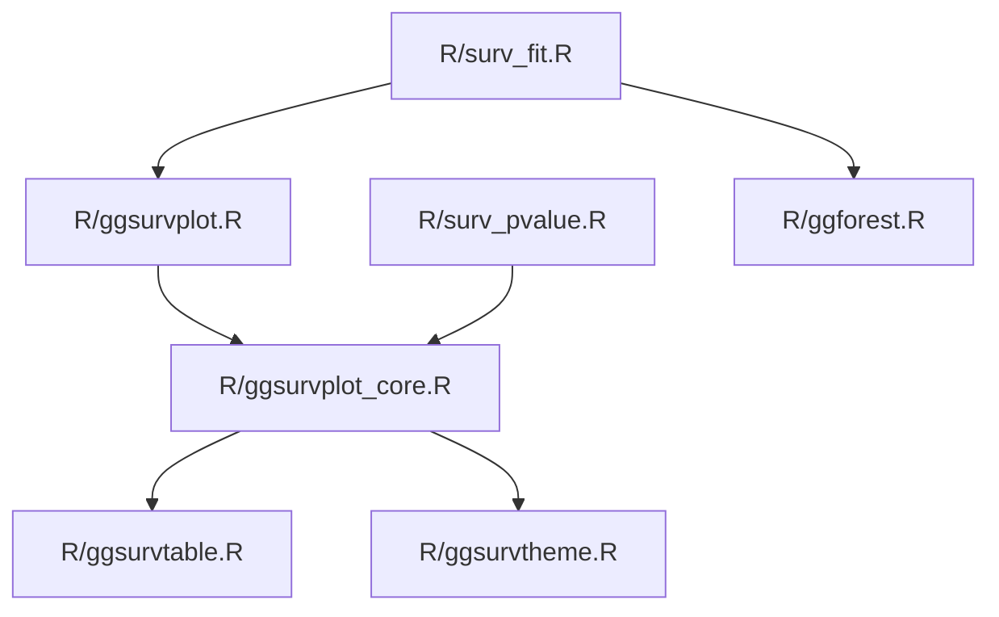

# kassambara/survminer

> Paquet R qui trace des courbes de survie, des forêts de Cox et des diagnostics, pour statisticiens.

## Le problème
Les graphiques de survie de base de R sont austères : pas de tableau des sujets à risque, p-valeur à ajouter à la main.

## Ce que ça fait vraiment
`ggsurvplot` dessine des courbes de Kaplan-Meier avec tableau de risque, p-valeur et intervalles de confiance. D'autres fonctions couvrent les diagnostics du modèle de Cox, les forêts, les risques concurrents, le RMST et la préparation de données CDISC ADTTE.

## Comment c'est branché


## Essayer
```bash
# dans R
install.packages("survminer")
library("survminer")
require("survival")
fit <- survfit(Surv(time, status) ~ sex, data = lung)
ggsurvplot(fit, data = lung)
```

## Coût et pièges
Gratuit. Nécessite R et le paquet survival. Aucune licence déclarée sur GitHub : vérifier la licence CRAN avant un usage commercial.

## Ce que ce n'est pas
Ce n'est pas un moteur d'estimation : il s'appuie sur survival pour l'ajustement. Il est centré sur le tracé, pas sur la modélisation.

## Alternatives
- survival (utilisé en dessous, pour l'ajustement, sans graphiques riches).

## Pour toi
À surveiller : utile seulement si tu fais de l'analyse de survie en R ; rien pour un pipeline Python ou MLOps.

