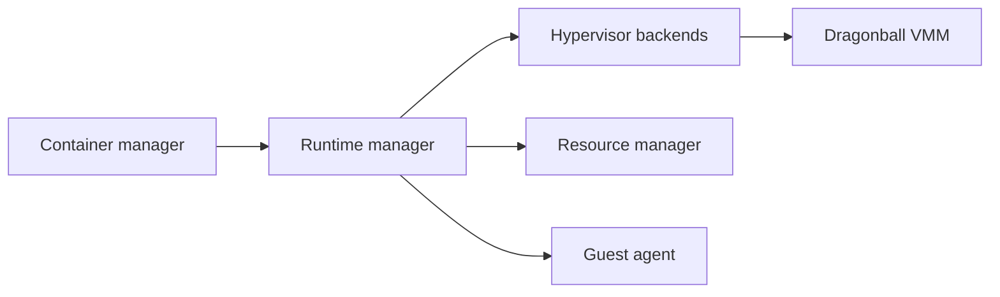

# kata-containers/kata-containers

> Container runtime that runs containers in micro virtual machines, for VM-grade isolation.

## The problem
Containers share the host kernel; for untrusted workloads, you want VM isolation without losing speed.

## What it actually does
A containerd-compatible runtime (shim v2), in Go and Rust, launches each pod in a lightweight VM. An agent inside the VM prepares the container; the hypervisor is configurable, including the built-in Dragonball VMM. A single configuration covers runtime, agent and hypervisor. Tools: `kata-ctl`, `agent-ctl`, osbuilder, kata-deploy (Helm chart).

## How it is wired


## Trying it
```bash
kata-runtime check
```
Checks whether the machine can create a Kata container (`--no-network-checks` option to avoid the network call).

## Cost and gotchas
Free, Apache-2.0. Requires virtualization-capable hardware and host. Architecture 4.0 and the Rust runtime coexist with the old Go runtime.

## What it is not
Not an orchestrator: it plugs in under Kubernetes or containerd. Performance cost figures are not in the README.

## Alternatives
No alternative named in the README.

## For you
Keep an eye on it: interesting for isolating multi-tenant workloads (notebooks, third-party jobs) on Kubernetes.
