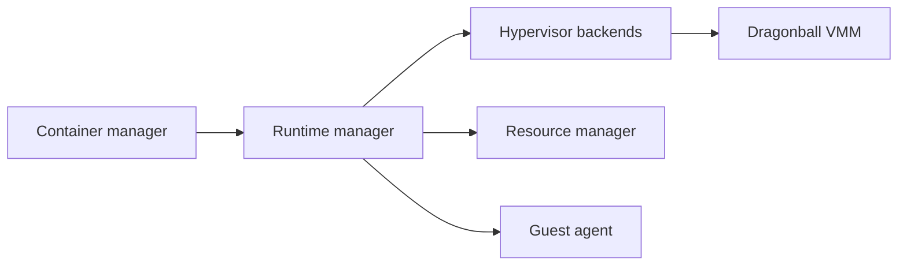

# kata-containers/kata-containers

> Environnement d'exécution de conteneurs dans des micro-machines virtuelles, pour une isolation de type VM.

## Le problème
Les conteneurs partagent le noyau de l'hôte ; pour des charges peu fiables, on veut l'isolation d'une VM sans en perdre la vitesse.

## Ce que ça fait vraiment
Un runtime compatible containerd (shim v2), en Go et en Rust, lance chaque pod dans une VM légère. Un agent dans la VM prépare le conteneur ; l'hyperviseur est au choix, dont le VMM intégré Dragonball. Une seule configuration couvre runtime, agent et hyperviseur. Outils : `kata-ctl`, `agent-ctl`, osbuilder, kata-deploy (chart Helm).

## Comment c'est branché


## Essayer
```bash
kata-runtime check
```
Contrôle si la machine peut créer un conteneur Kata (option `--no-network-checks` pour éviter l'appel réseau).

## Coût et pièges
Gratuit, Apache-2.0. Exige un matériel et un hôte capables de virtualisation. Architecture 4.0 et runtime Rust coexistent avec l'ancien runtime Go.

## Ce que ce n'est pas
Pas un orchestrateur : il se branche sous Kubernetes ou containerd. Les chiffres de coût de performance ne figurent pas dans le README.

## Alternatives
Aucune alternative nommée dans le README.

## Pour toi
Surveiller : intéressant pour isoler des charges multi-locataires (notebooks, jobs tiers) sur Kubernetes.

