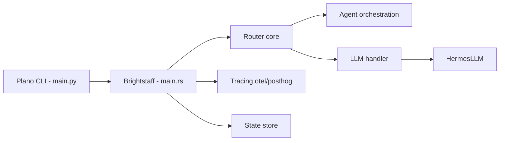

# katanemo/plano

> Proxy and data plane for agent applications: agent routing, model routing, guardrails, traces.

## The problem
Moving from an agent demo to production forces you to write a "hidden middleware": routing to the right agent, moderation, observability, adaptation to model providers.

## What it actually does
A Rust server (`brightstaff`) driven by a `config.yaml`: it directs requests to OpenAI-compatible HTTP agents, chooses the model by name, alias or preferences, applies filter chains (guardrails, memory) and emits OpenTelemetry traces. `hermesllm` translates between OpenAI, Anthropic, Bedrock. Agent routing uses a 4-billion-parameter model hosted for free (US region) or run locally.

## How it is wired


## Trying it
```bash
planoai up config.yaml
curl http://localhost:8001/v1/chat/completions \
  -H "Content-Type: application/json" \
  -d '{"model": "gpt-4o", "messages": [{"role": "user", "content": "I want to travel from NYC to Paris next week. What is the weather like there, and can you find me some flights?"}]}'
```

## Cost and gotchas
Provider API keys are at your expense. The orchestration model is hosted for free for getting started; in production, run it locally or ask for keys. The code mentions PostHog in addition to OTEL.

## What it is not
Not an agent framework: your agents are still yours to write. Nor is it a simple LLM client: it is an infrastructure component to deploy.

## Alternatives
No alternative is named in the README.

## For you
Worth watching if you are industrializing multi-agent systems: it centralizes routing and traces, but depends on a hosted routing model and the project is young (created in 2024, 147 open issues).
