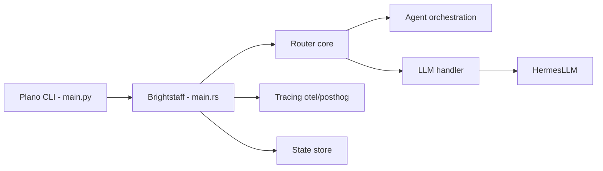

# katanemo/plano

> Proxy et plan de données pour applications d'agents : routage d'agents, routage de modèles, garde-fous, traces.

## Le problème
Passer d'une démo d'agents à la production oblige à écrire un « middleware caché » : routage vers le bon agent, modération, observabilité, adaptation aux fournisseurs de modèles.

## Ce que ça fait vraiment
Serveur Rust (`brightstaff`) piloté par un `config.yaml` : il oriente les requêtes vers des agents HTTP compatibles OpenAI, choisit le modèle par nom, alias ou préférences, applique des chaînes de filtres (garde-fous, mémoire) et émet traces OpenTelemetry. `hermesllm` traduit entre OpenAI, Anthropic, Bedrock. Le routage d'agents utilise un modèle de 4 milliards de paramètres hébergé gratuitement (région US) ou local.

## Comment c'est branché


## Essayer
```bash
planoai up config.yaml
curl http://localhost:8001/v1/chat/completions \
  -H "Content-Type: application/json" \
  -d '{"model": "gpt-4o", "messages": [{"role": "user", "content": "I want to travel from NYC to Paris next week. What is the weather like there, and can you find me some flights?"}]}'
```

## Coût et pièges
Clés API des fournisseurs à ta charge. Le modèle d'orchestration est hébergé gratuitement pour le démarrage ; en production, l'exécuter en local ou demander des clés. Le code mentionne PostHog en plus d'OTEL.

## Ce que ce n'est pas
Pas un framework d'agents : tes agents restent à écrire. Pas non plus un simple client LLM : c'est un composant d'infrastructure à déployer.

## Alternatives
Aucune alternative nommée dans le README.

## Pour toi
À surveiller si tu industrialises des systèmes multi-agents : il centralise routage et traces, mais dépend d'un modèle de routage hébergé et le projet est jeune (créé en 2024, 147 issues ouvertes).

