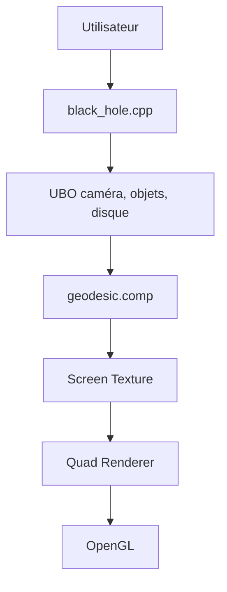

# kavan010/black_hole

> Black hole simulation in C++ and OpenGL, with gravitational lensing computed on CPU or GPU.

## The problem
Visualizing the bending of light around a black hole requires physics and rendering code that is rarely provided ready to compile.

## What it actually does
Three paths: 2D lensing on CPU (`2D_lensing.cpp`), 3D on GPU where `black_hole.cpp` sends UBO buffers to the `geodesic.comp` shader, and a separate scene ray tracer (`ray_tracing.cpp`). Optional accretion disk parameters and spacetime grid. Tested only on Windows with the author's GPU.

## How it is wired


## Trying it
```bash
git clone https://github.com/kavan010/black_hole.git
cd ./black_hole
vcpkg install
mkdir build
cmake -B build -S . -DCMAKE_TOOLCHAIN_FILE=/path/to/vcpkg/scripts/buildsystems/vcpkg.cmake
cmake --build build
```

## Cost and gotchas
Free. You need a C++17 compiler, CMake, vcpkg and a GPU. No license declared: reuse is uncertain. Last push in April 2026.

## What it is not
Not a validated scientific simulator: a visual demo by a single author. The README announces a work in progress.

## Alternatives
No alternative named in the README.

## For you
Ignore: graphics demo without a license, outside the data/AI/MLOps scope.
