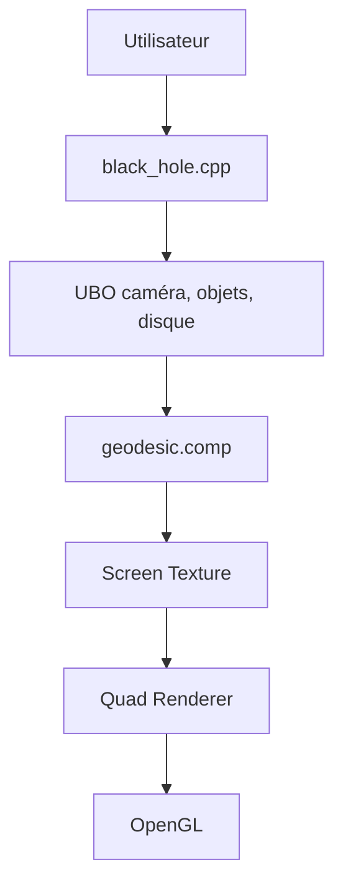

# kavan010/black_hole

> Simulation de trou noir en C++ et OpenGL, avec lentille gravitationnelle calculée sur CPU ou GPU.

## Le problème
Visualiser la déviation de la lumière autour d'un trou noir demande un code de physique et de rendu rarement fourni prêt à compiler.

## Ce que ça fait vraiment
Trois chemins : lentille 2D sur CPU (`2D_lensing.cpp`), 3D sur GPU où `black_hole.cpp` envoie des tampons UBO au shader `geodesic.comp`, et un lancer de rayons de scène séparé (`ray_tracing.cpp`). Paramètres de disque d'accrétion et grille d'espace-temps en option. Testé seulement sous Windows avec le GPU de l'auteur.

## Comment c'est branché


## Essayer
```bash
git clone https://github.com/kavan010/black_hole.git
cd ./black_hole
vcpkg install
mkdir build
cmake -B build -S . -DCMAKE_TOOLCHAIN_FILE=/path/to/vcpkg/scripts/buildsystems/vcpkg.cmake
cmake --build build
```

## Coût et pièges
Gratuit. Il faut un compilateur C++17, CMake, vcpkg et un GPU. Aucune licence déclarée : réutilisation incertaine. Dernier push en avril 2026.

## Ce que ce n'est pas
Pas un simulateur scientifique validé : démonstration visuelle d'un seul auteur. Le README annonce un projet en cours.

## Alternatives
Aucune alternative nommée dans le README.

## Pour toi
À ignorer : démonstration graphique sans licence, hors du périmètre data/IA/MLOps.

