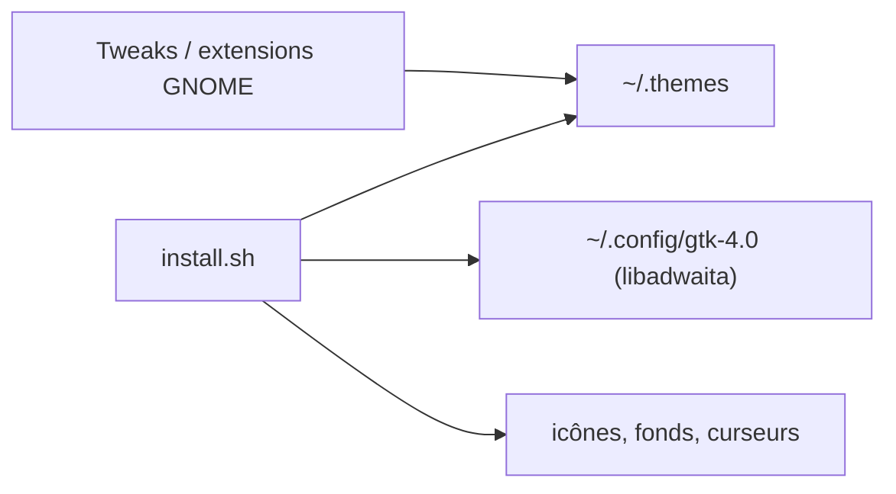

# kayozxo/GNOME-macOS-Tahoe

> GTK and GNOME Shell theme imitating macOS Tahoe, with sixteen accent colors.

## The problem
A GNOME desktop that looks like macOS requires assembling theme, icons, cursors and extensions.

## What it actually does
An interactive `install.sh` script (or with flags) installs light and dark themes, generates sixteen accent variants for GTK4, GTK3 and GNOME Shell, applies a workaround for libadwaita and adds icons, wallpapers, cursors and Ulauncher and GDM themes. The README lists recommended GNOME extensions.

## How it is wired


## Trying it
```bash
git clone https://github.com/kayozxo/GNOME-macOS-Tahoe
cd GNOME-macOS-Tahoe
./install.sh
```

## Cost and gotchas
Free. The libadwaita workaround overwrites the GTK4 configuration and pins one theme for all applications. Flatpak requires permission overrides.

## What it is not
Not an official theme nor perfect for libadwaita (the README admits it). No license declared: reuse is uncertain.

## Alternatives
No alternative named in the README (points to MacTahoe and WhiteSur for icons and cursors).

## For you
Ignore: a desktop theme with no link to data/AI, and no license.
