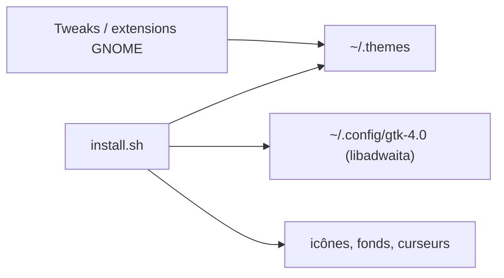

# kayozxo/GNOME-macOS-Tahoe

> Thème GTK et GNOME Shell imitant macOS Tahoe, avec seize couleurs d'accent.

## Le problème
Un bureau GNOME qui ressemble à macOS demande d'assembler thème, icônes, curseurs et extensions.

## Ce que ça fait vraiment
Un script `install.sh` interactif (ou avec drapeaux) installe thèmes clair et sombre, génère seize variantes d'accent pour GTK4, GTK3 et GNOME Shell, applique un contournement pour libadwaita et ajoute icônes, fonds, curseurs et thèmes Ulauncher et GDM. Le README liste des extensions GNOME recommandées.

## Comment c'est branché


## Essayer
```bash
git clone https://github.com/kayozxo/GNOME-macOS-Tahoe
cd GNOME-macOS-Tahoe
./install.sh
```

## Coût et pièges
Gratuit. Le contournement libadwaita écrase la configuration GTK4 et fige un thème pour toutes les applications. Flatpak demande des surcharges de permissions.

## Ce que ce n'est pas
Pas un thème officiel ni parfait pour libadwaita (le README le reconnaît). Aucune licence déclarée : réutilisation incertaine.

## Alternatives
Aucune alternative nommée dans le README (renvoie à MacTahoe et WhiteSur pour icônes et curseurs).

## Pour toi
À ignorer : thème de bureau sans lien avec la data/IA, et sans licence.

