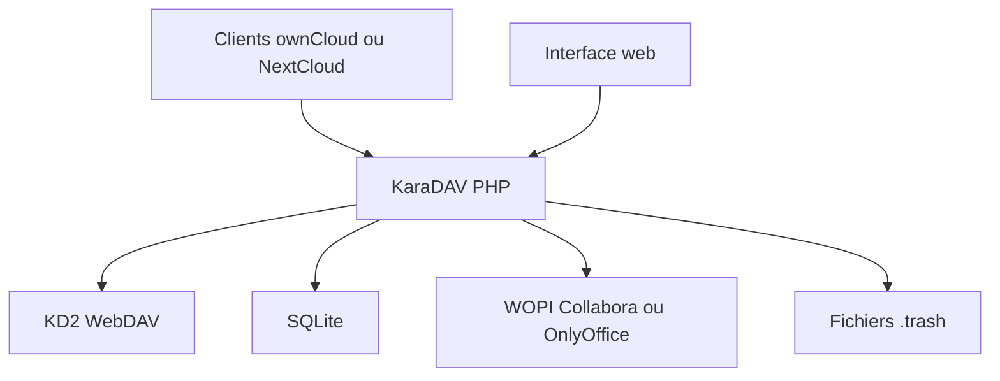

# kd2org/karadav

> Lightweight WebDAV server in PHP, compatible with ownCloud and NextCloud clients, for sharing files.

## The problem
NextCloud is heavy for someone who only wants to sync files, yet its clients are the best.

## What it actually does
WebDAV server in PHP 8 with SQLite, multiple accounts, quotas, trash, LDAP, a web file manager and Office editing via WOPI (Collabora, OnlyOffice). It imitates NextCloud endpoints so that desktop and Android clients work. About 7,500 lines of code according to the README.

## How it is wired
Simplified diagram based on the sheet, no diagram provided.

## Trying it
No installation command in the README: it points to the installation documentation. The only command present generates 300 test files with `dd` for the performance test.

## Cost and gotchas
PHP 8+ and SQLite3 only. iOS clients are blocked by default to avoid data loss. The project is maintained in one person's spare time, and NextCloud clients may break compatibility at any time.

## What it is not
Not a NextCloud replacement: no calendar, contacts, 2FA, nor (for now) sharing or versions. AI-generated contributions are refused.

## Alternatives
- dav-next: nginx module, the closest to KaraDAV.
- Apache mod_dav: fast and simple, without NextCloud compatibility.
- SFTPGo: file server without NextCloud clients.

## For you
Watch: handy for simple personal file storage, but of no direct interest for a data / AI workflow.
