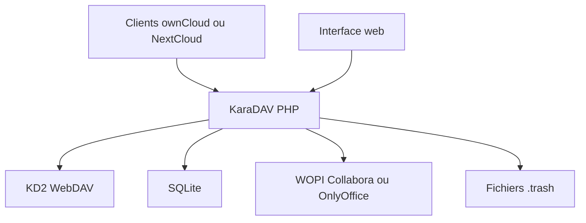

# kd2org/karadav

> Serveur WebDAV léger en PHP, compatible avec les clients ownCloud et NextCloud, pour partager des fichiers.

## Le problème
NextCloud est lourd pour qui veut seulement synchroniser des fichiers, alors que ses clients sont les meilleurs.

## Ce que ça fait vraiment
Serveur WebDAV en PHP 8 avec SQLite, comptes multiples, quotas, corbeille, LDAP, gestionnaire de fichiers web et édition Office via WOPI (Collabora, OnlyOffice). Il imite les points d'accès NextCloud pour que les clients de bureau et Android fonctionnent. Environ 7 500 lignes de code selon le README.

## Comment c'est branché
Schéma simplifié d'après la fiche, sans diagramme fourni.

## Essayer
Aucune commande d'installation dans le README : renvoi vers la documentation d'installation. Seule commande présente : génération de 300 fichiers de test avec `dd` pour le test de performance.

## Coût et pièges
PHP 8+ et SQLite3 seulement. Les clients iOS sont bloqués par défaut pour éviter des pertes de données. Le projet est maintenu sur le temps libre d'une personne, et les clients NextCloud peuvent casser la compatibilité à tout moment.

## Ce que ce n'est pas
Pas un remplaçant de NextCloud : pas de calendrier, contacts, 2FA, ni (pour l'instant) partage ou versions. Les contributions générées par IA sont refusées.

## Alternatives
- dav-next : module nginx, le plus proche de KaraDAV.
- Apache mod_dav : rapide et simple, sans compatibilité NextCloud.
- SFTPGo : serveur de fichiers sans clients NextCloud.

## Pour toi
Surveiller : pratique pour un stockage de fichiers perso simple, mais sans intérêt direct pour un flux data / IA.

