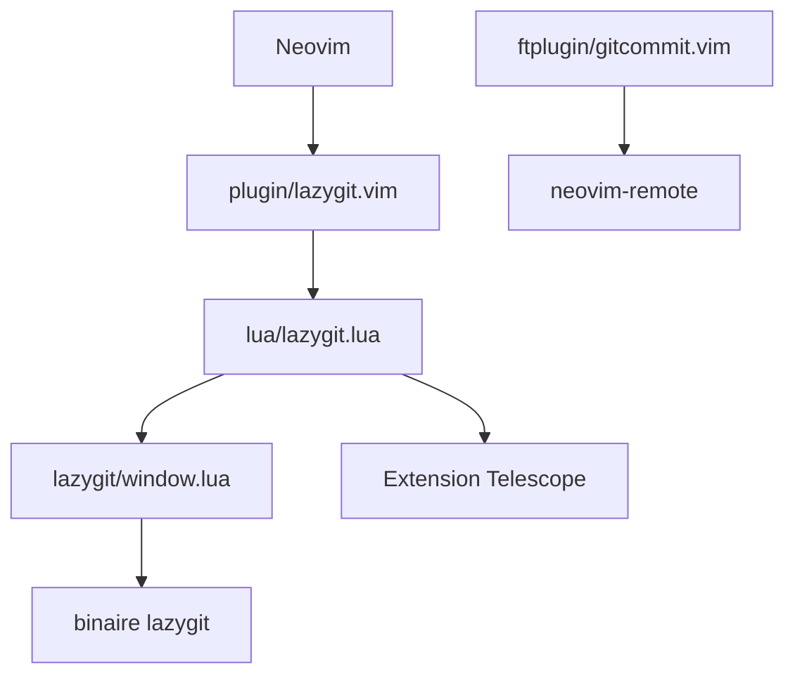

# kdheepak/lazygit.nvim

> Neovim plugin that opens lazygit in a floating window, for those who live in the editor.

## The problem
Switching from an editor to a terminal to manage Git breaks the flow of work.

## What it actually does
The plugin launches the lazygit binary in a floating window via the :LazyGit command, with variants (current file, configuration, filtered history). It can rely on neovim-remote to edit commit messages in the same instance. A Telescope extension keeps the list of visited repositories, useful with submodules.

## How it is wired


## Trying it
```lua
return {
    "kdheepak/lazygit.nvim",
    lazy = true,
    cmd = { "LazyGit", "LazyGitConfig", "LazyGitCurrentFile", "LazyGitFilter", "LazyGitFilterCurrentFile" },
    dependencies = { "nvim-lua/plenary.nvim" },
    keys = { { "<leader>lg", "<cmd>LazyGit<cr>", desc = "LazyGit" } }
}
```

## Cost and gotchas
Free. The lazygit binary must be installed separately; neovim-remote is optional. The README asks for Neovim 0.7.2 or newer depending on the package manager.

## What it is not
It is not lazygit itself, only its launcher. It is not a Git interface native to Neovim.

## Alternatives
- akinsho/nvim-toggleterm: generic floating terminal.
- voldikss/vim-floaterm: same idea, independent of Git.

## For you
Worth watching: handy if you write your notebooks and pipelines in Neovim; otherwise lazygit alone in a terminal is enough.
