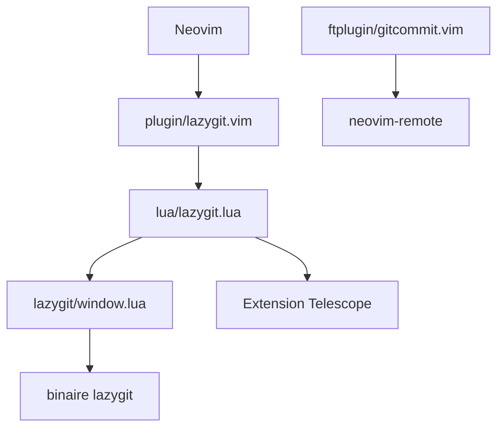

# kdheepak/lazygit.nvim

> Plugin Neovim qui ouvre lazygit dans une fenêtre flottante, pour qui vit dans l'éditeur.

## Le problème
Passer d'un éditeur à un terminal pour gérer Git casse le fil du travail.

## Ce que ça fait vraiment
Le plugin lance le binaire lazygit dans une fenêtre flottante via la commande :LazyGit, avec des variantes (fichier courant, configuration, historique filtré). Il peut s'appuyer sur neovim-remote pour éditer les messages de commit dans la même instance. Une extension Telescope garde la liste des dépôts visités, utile avec des sous-modules.

## Comment c'est branché


## Essayer
```lua
return {
    "kdheepak/lazygit.nvim",
    lazy = true,
    cmd = { "LazyGit", "LazyGitConfig", "LazyGitCurrentFile", "LazyGitFilter", "LazyGitFilterCurrentFile" },
    dependencies = { "nvim-lua/plenary.nvim" },
    keys = { { "<leader>lg", "<cmd>LazyGit<cr>", desc = "LazyGit" } }
}
```

## Coût et pièges
Gratuit. Le binaire lazygit doit être installé à part ; neovim-remote est facultatif. Le README demande Neovim 0.7.2 ou plus récent selon le gestionnaire de paquets.

## Ce que ce n'est pas
Ce n'est pas lazygit lui-même, seulement son lanceur. Ce n'est pas une interface Git native à Neovim.

## Alternatives
- akinsho/nvim-toggleterm : terminal flottant générique.
- voldikss/vim-floaterm : même idée, indépendante de Git.

## Pour toi
À surveiller : pratique si tu codes tes notebooks et pipelines sous Neovim ; sinon lazygit seul dans un terminal suffit.

