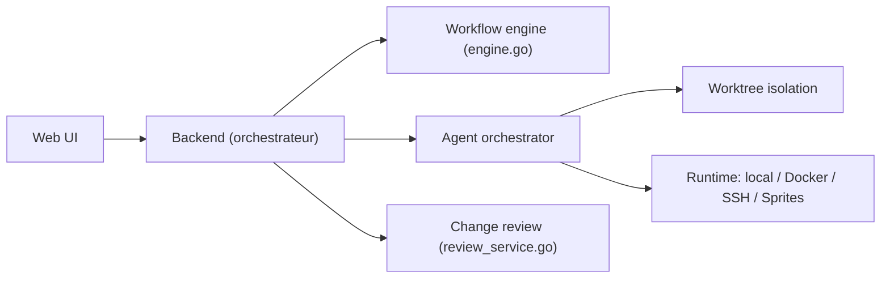

# kdlbs/kandev

> Self-hostable control plane for running coding agents in parallel and reviewing their changes.

## The problem
Agent TUIs are fine for running things, but reviewing and iterating across several parallel tasks does not scale there.

## What it actually does
Kanban board and task pipelines; each task runs in an isolated git worktree, as a local process, Docker container, over SSH or in the cloud. Over twenty agents to choose from (Claude Code, Codex, Copilot, Gemini CLI…). Built-in workspace with editor, terminal and diff, plus GitHub, GitLab, Jira and Linear integrations. An "Office" mode is under development. No telemetry according to the README.

## How it is wired


## Trying it
```bash
brew install kdlbs/kandev/kandev
kandev
npx kandev@latest
```

## Cost and gotchas
Free; agent subscriptions or keys are on you. Docker is optional. 135 open issues. AGPL-3.0.

## What it is not
Not an agent itself: it orchestrates them. Office mode is not yet a documented way of working.

## Alternatives
No alternative named in the README.

## For you
Worth watching: useful if you run several coding agents and want centralized review; young and evolving quickly.
