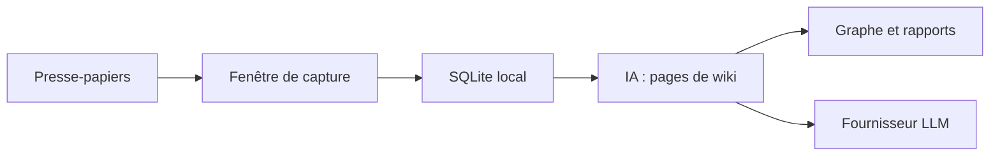

# kdsz001/OpenWiki

> Desktop application that captures what you copy and files it into an AI knowledge base.

## The problem
What you copy throughout the day gets lost, with no sorting and no links between notes.

## What it actually does
A window opens at each copy: you choose whether to keep it or not. The AI compiles the content into wiki pages (concepts, entities), draws a graph, answers questions and produces a weekly report. Data in local SQLite. Providers: Anthropic, OpenAI or Gemini.

## How it is wired
Simplified diagram based on the sheet, no diagram provided.


## Trying it
```bash
git clone https://github.com/kdsz001/OpenWiki.git
cd OpenWiki
npm install
npm run tauri dev
```

## Cost and gotchas
API key from a provider, at your expense. Reading a URL sends the address to Jina Reader, and translation goes through Google Translate (both can be disabled). Unsigned Windows build. Building requires Node 18+ and Rust.

## What it is not
It is not 100% offline: the captured content goes to the LLM you choose. No Linux version announced.

## Alternatives
No alternative named in the README.

## For you
Worth watching: a good idea for an AI-fed wiki, but young, single-maintainer, and your content transits through an external LLM.
