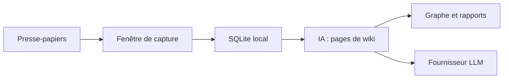

# kdsz001/OpenWiki

> Application de bureau qui capture ce que tu copies et le range en base de connaissances par IA.

## Le problème
Ce qu'on copie au fil de la journée se perd, sans tri ni lien entre les notes.

## Ce que ça fait vraiment
Une fenêtre s'ouvre à chaque copie : tu choisis de garder ou non. L'IA compile le contenu en pages de wiki (concepts, entités), dessine un graphe, répond à des questions et produit un rapport hebdomadaire. Données en SQLite local. Fournisseurs Anthropic, OpenAI ou Gemini.

## Comment c'est branché
Schéma simplifié d'après la fiche, sans diagramme fourni.


## Essayer
```bash
git clone https://github.com/kdsz001/OpenWiki.git
cd OpenWiki
npm install
npm run tauri dev
```

## Coût et pièges
Clé d'API d'un fournisseur à ta charge. Lire une URL envoie l'adresse à Jina Reader, et la traduction passe par Google Translate (désactivables). Build Windows non signée. Compilation : Node 18+ et Rust.

## Ce que ce n'est pas
Ce n'est pas 100 % hors ligne : le contenu capturé part vers le LLM choisi. Pas de version Linux annoncée.

## Alternatives
Aucune alternative nommée dans le README.

## Pour toi
À surveiller : bonne idée de wiki alimenté par l'IA, mais jeune, mono-mainteneur, et ton contenu transite par un LLM externe.

