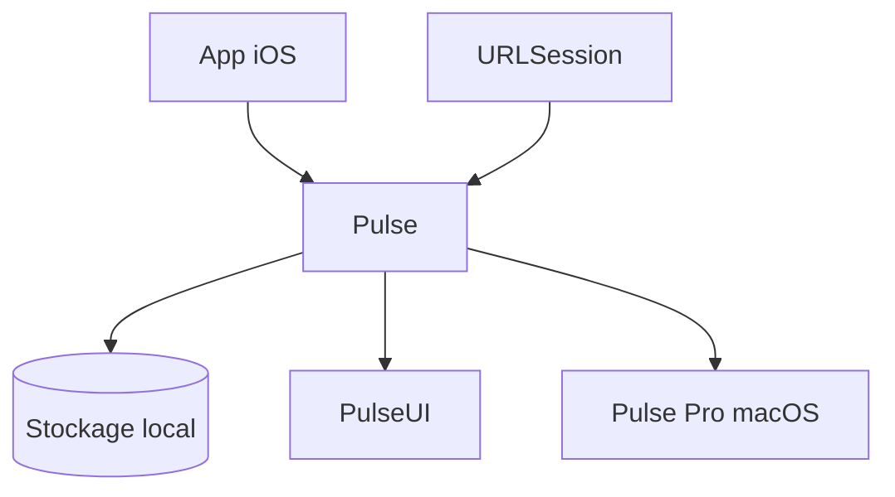

# kean/Pulse

> Native logging system for Apple platforms, with a URLSession network inspector built into the app.

## The problem
iOS teams lack visibility into logs and network requests of test builds.

## What it actually does
A Swift framework that records `URLSession` events (including Alamofire) and logs, stored locally, with SwiftUI views (PulseUI) to embed in the app. A SwiftLog backend exists. Logs can be shared or viewed live in Pulse Pro, a macOS application.

## How it is wired

Diagram not provided: simplified diagram based on the README.

## Trying it
```bash
# Aucune commande dans le README : suivre le guide Getting Started (Swift Package Manager).
```

## Cost and gotchas
The framework is free. Pulse Pro is a separate application, probably paid (not specified). Pulse 5.0 requires Swift 5.10 and Xcode 15.4.

## What it is not
Not a network proxy: the README points to Proxyman for that.

## Alternatives
- Proxyman: network proxy, to capture traffic outside the app.

## For you
Ignore: reserved for Apple development, unrelated to data, AI or MLOps.
