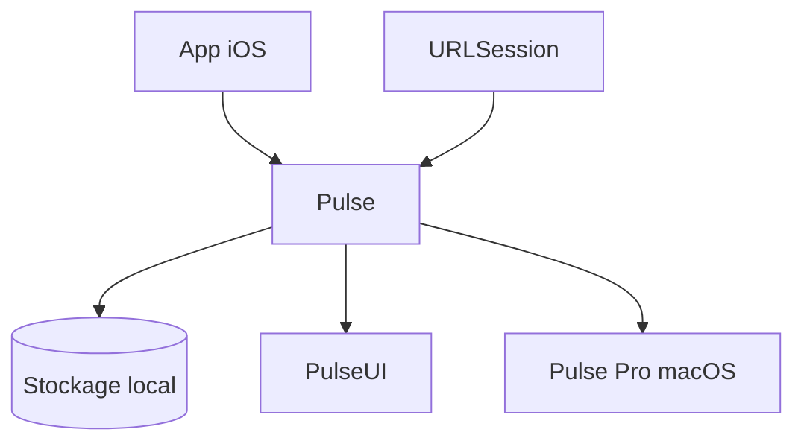

# kean/Pulse

> Système de journalisation natif pour plateformes Apple, avec inspecteur réseau URLSession intégré à l'app.

## Le problème
Les équipes iOS manquent de visibilité sur logs et requêtes réseau des builds de test.

## Ce que ça fait vraiment
Un framework Swift qui enregistre les événements `URLSession` (y compris Alamofire) et les logs, stockés en local, avec des vues SwiftUI (PulseUI) à intégrer dans l'app. Un backend SwiftLog existe. Les logs se partagent ou se voient en direct dans Pulse Pro, application macOS.

## Comment c'est branché

Schéma non fourni : diagramme simplifié d'après le README.

## Essayer
```bash
# Aucune commande dans le README : suivre le guide Getting Started (Swift Package Manager).
```

## Coût et pièges
Le framework est gratuit. Pulse Pro est une application distincte, probablement payante (non précisé). Pulse 5.0 demande Swift 5.10 et Xcode 15.4.

## Ce que ce n'est pas
Pas un proxy réseau : le README cite Proxyman pour cela.

## Alternatives
- Proxyman : proxy réseau, pour capturer le trafic hors de l'app.

## Pour toi
À ignorer : réservé au développement Apple, sans lien avec data, IA ou MLOps.

