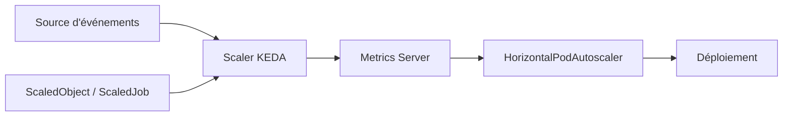

# kedacore/keda

> Event-driven Kubernetes autoscaling, down to zero replicas, with no external dependency.

## The problem
Kubernetes' HPA natively measures only CPU and memory: a filling RabbitMQ queue or a lagging storage queue triggers no scaling, and nothing scales down to zero.

## What it actually does
KEDA installs as a Kubernetes Metrics Server and adds a dedicated CRD to declare autoscaling rules based on event sources. It integrates natively with the Horizontal Pod Autoscaler and works equally well in the cloud and at the edge, with no external dependency. A CNCF **graduated** project.

## How it is wired

## Trying it
No command is given in this README: it points to Helm, Operator Hub or YAML files, and to keda.sh for the documentation.

## Cost and gotchas
Free. You need a Kubernetes cluster and access to the monitored event source (queue, topic, storage) — so, where applicable, a cloud account and its quotas.

## What it is not
Not a scheduler: KEDA decides the number of replicas, it is the HPA and Kubernetes that place them.
Not a GPU or AI tool. The README is essentially a table of contents: the useful material is elsewhere. License not declared here.

## Alternatives
No alternative repository is named in the README.

## For you
The standard building block if your inference or ETL workers must follow a queue and drop to zero.
