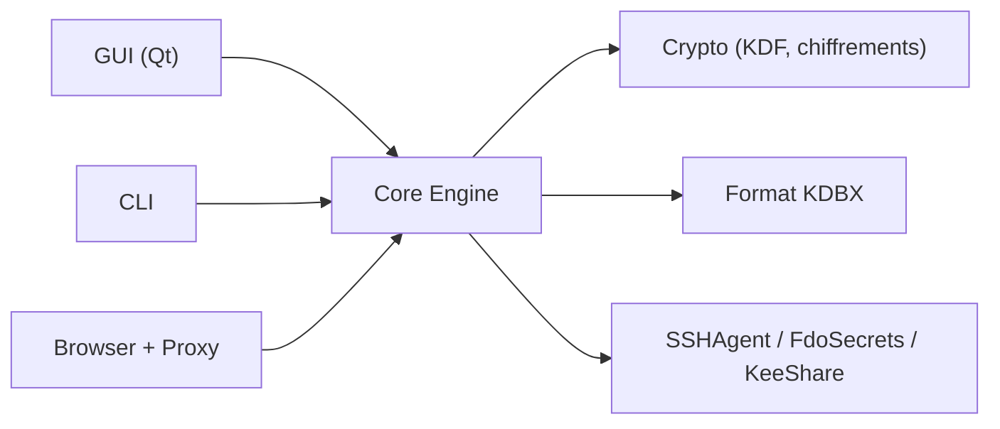

# keepassxreboot/keepassxc

> Offline, cross-platform password manager, compatible with KeePass (KDBX).

## The problem
Passwords and secrets must stay encrypted and under your control, without depending on an online service.

## What it actually does
An encrypted KDBX database holds credentials, URLs, notes and attachments, with a password generator, TOTP, auto-type, passkeys via browser integration, an SSH agent, YubiKey support and the `keepassxc-cli` CLI. It imports CSV, 1Password, Bitwarden and Proton Pass. The README states that code mostly generated by AI is flagged in the pull request.

## How it is wired

## Trying it
No command in the README: download the binaries from the download page, build guide in the wiki.

## Cost and gotchas
Free. A license is present but not identified by GitHub: to be checked. 946 open issues.

## What it is not
No built-in synchronization: the database is a file that you store wherever you want.

## Alternatives
No alternative named in the README apart from KeePass compatibility.

## For you
To adopt, to keep API keys and credentials out of a SaaS, with the license to be confirmed if you redistribute.
