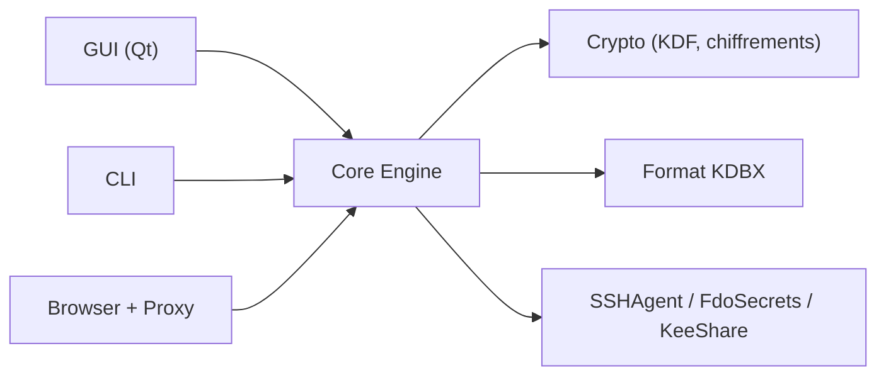

# keepassxreboot/keepassxc

> Gestionnaire de mots de passe hors ligne, multiplateforme, compatible KeePass (KDBX).

## Le problème
Les mots de passe et secrets doivent rester chiffrés, sous ton contrôle, sans dépendre d'un service en ligne.

## Ce que ça fait vraiment
Une base KDBX chiffrée contient identifiants, URL, notes et pièces jointes, avec générateur de mots de passe, TOTP, saisie automatique, passkeys via intégration navigateur, agent SSH, YubiKey et CLI `keepassxc-cli`. Il importe CSV, 1Password, Bitwarden et Proton Pass. Le README précise que le code généré par IA en majorité est signalé dans la pull request.

## Comment c'est branché

## Essayer
Aucune commande dans le README : téléchargement des binaires depuis la page de téléchargement, guide de compilation dans le wiki.

## Coût et pièges
Gratuit. Licence présente mais non identifiée par GitHub : à vérifier. 946 issues ouvertes.

## Ce que ce n'est pas
Pas de synchronisation intégrée : la base est un fichier que tu stockes où tu veux.

## Alternatives
Aucune alternative nommée dans le README en dehors d'une compatibilité avec KeePass.

## Pour toi
À adopter pour garder clés d'API et accès hors d'un SaaS, avec la licence à confirmer si tu redistribues.

